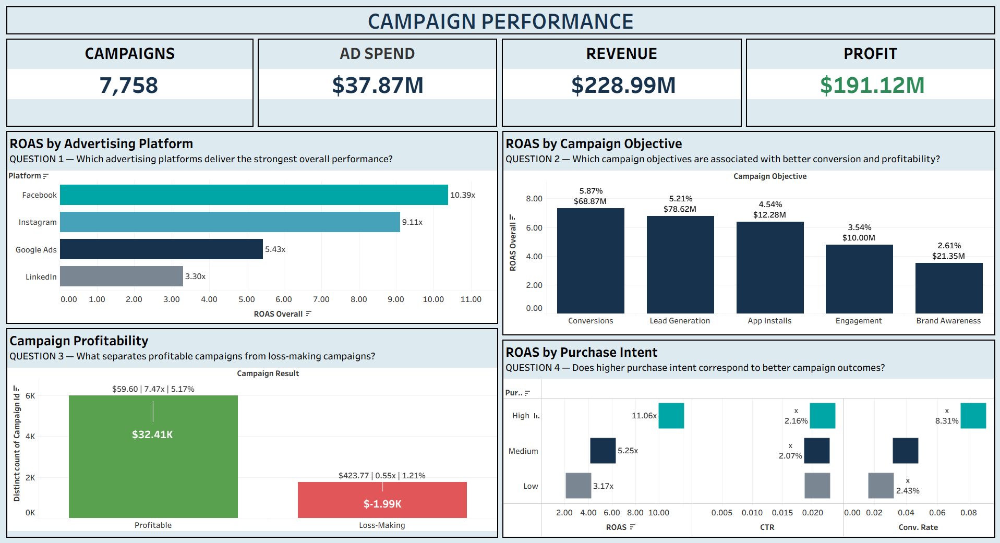
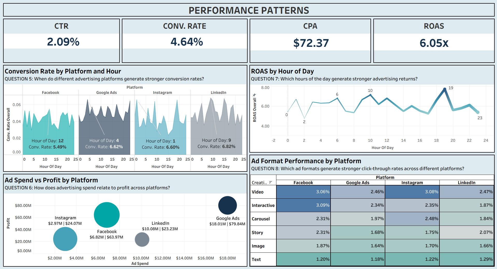

# Digital Advertising Campaign Analysis - Tableau

This project analyzes digital advertising campaign performance to understand how different advertising platforms, campaign objectives, and creative formats 
influence marketing efficiency and profitability. Using Excel, MySQL, and Tableau, the project explores campaign spending, revenue generation, conversions, audience engagement, and performance patterns to identify opportunities for better advertising decisions.

---

## 📌 Project Objectives

- Compare advertising performance across platforms.
- Evaluate campaign profitability and return on advertising spend.
- Analyze click-through rates and conversion performance.
- Identify patterns across campaign objectives, creative formats, and time of day.
- Generate actionable insights to support data-driven marketing decisions.

---

## 📊 Dataset

- **Source:** Kaggle.
- **Original records:** 10,000 campaigns.
- **Original columns:** 41.
- **Final analysis:** 7,758 campaigns after excluding TikTok and Twitter platforms.

---

## 🛠️ Tools

- **Microsoft Excel:** Data cleaning, handling missing values, and preparing the dataset.
- **MySQL Workbench:** SQL queries for business analysis questions.
- **Tableau:** Interactive dashboards, data visualization, and performance comparisons.

---

## 🧹 Data Preparation

- Reviewing data quality and identifying missing values.
- Cleaning and organizing campaign data.
- Handling missing Cost Per Acquisition (CPA) values for campaigns with zero conversions.
- Excluding TikTok and Twitter to focus the final analysis on Facebook, Google Ads, Instagram, and LinkedIn.
- Preparing the cleaned dataset for SQL analysis and Tableau visualization.

---

## 🔎 SQL Analysis

SQL was used to answer business questions and decide whether visualization was needed.

- Platform-wise campaign performance and profitability.
- Campaign objective effectiveness.
- Creative format performance.
- Relationships between ROAS, CPA, and campaign profitability.
- Performance variations across different hours of the day.

---

## 📈 Dashboards

### Dashboard 1 — CAMPAIGN PERFORMANCE
Focuses on overall campaign results, including advertising spend, revenue, profit, and key efficiency metrics. It supports comparisons across platforms and campaign objectives.

### Dashboard 2 — PERFORMANCE PATTERNS
Explores differences in campaign performance across creative formats and hours of the day, helping identify patterns in engagement, conversions, and advertising 
efficiency.

---

## 🖼️ Screenshots

### Dashboard 1

### Dashboard 2

---

## 🔎 Key Insights
- **Platform Efficiency:** Facebook delivered the highest ROAS, while LinkedIn had the highest CPA.
- **Campaign Objectives:** Conversion-focused campaigns delivered the best conversion rates and ROAS.
- **Profitability:** Profitable campaigns achieved higher ROAS and lower CPA.
- **Timing:** Campaign performance varied by hour and platform.
- **Purchase Intent:** Purchase intent levels varied in engagement, conversions, and returns.

---

## 🎯 Conclusion

This project demonstrates an end-to-end data analytics workflow, from data preparation in Excel and business analysis using SQL to interactive reporting in Tableau. It showcases how data can be transformed into meaningful insights to evaluate advertising effectiveness and support data-driven marketing decisions.

---

## 👤 Author

**Krishna Thombare**
